```text
██████╗ ██████╗ ██╗   ██╗██████╗ ████████╗██╗     ██╗███╗   ██╗██╗  ██╗
██╔════╝ ██╔══██╗╚██╗ ██╔╝██╔══██╗╚══██╔══╝██║     ██║████╗  ██║██║ ██╔╝
██║      ██████╔╝ ╚████╔╝ ██████╔╝   ██║   ██║     ██║██╔██╗ ██║█████╔╝ 
██║      ██╔══██╗  ╚██╔╝  ██╔═══╝    ██║   ██║     ██║██║╚██╗██║██╔═██╗ 
╚██████╗ ██║  ██║   ██║   ██║        ██║   ███████╗██║██║ ╚████║██║  ██╗
 ╚═════╝ ╚═╝  ╚═╝   ╚═╝   ╚═╝        ╚═╝   ╚══════╝╚═╝╚═╝  ╚═══╝╚═╝  ╚═╝
```

# CryptLink

### High-Assurance End-to-End Encrypted Communications & Sentinel C4ISR Defense

[](https://github.com/CarterPerez-dev/Cybersecurity-Projects)
[](https://signal.org/docs/)
[](https://csrc.nist.gov/)
[](https://fidoalliance.org/)
[](LICENSE)
[](tests)

> **DEFCON 1 // TS-SCI Cryptographic Architecture**  
> CryptLink is a zero-knowledge, end-to-end encrypted (E2EE) tactical communications engine engineered for hostile network environments. It combines the **Signal Protocol** (Extended Triple Diffie-Hellman + Double Ratchet), **FIDO2/WebAuthn hardware passkeys**, out-of-band **Short Authentication String (SAS)** verification, synchronized **ephemeral zeroization**, and an interactive **Sentinel C4ISR Tactical Radar HUD**.

---

## Table of Contents

- [Core Defense Capabilities](#core-defense-capabilities)
- [Cryptographic Specifications](#cryptographic-specifications)
- [System Architecture & Data Flow](#system-architecture--data-flow)
- [Tactical HUD & Security Panels](#tactical-hud--security-panels)
- [Directory Layout](#directory-layout)
- [Quick Start & Deployment](#quick-start--deployment)
- [Testing & Security Audits](#testing--security-audits)
- [Curriculum & Learning Modules](#curriculum--learning-modules)
- [License & Copyleft](#license--copyleft)

---

## Core Defense Capabilities

### 1. Extended Triple Diffie-Hellman (X3DH) & Double Ratchet
- **Asymmetric Handshake:** Mutual identity authentication and pre-key agreement using Curve25519 (`X25519`) and Ed25519 digital signatures.
- **Continuous Key Ratcheting:** Advances symmetric HKDF ratchet chains on every message and asymmetric Diffie-Hellman chains on every response cycle.
- **Forward Secrecy & Break-In Recovery:** Discarded keys are permanently expunged. Even physical compromise of present keys cannot decrypt historical traffic or future messages.
- **Out-of-Order Decryption:** Accommodates out-of-order and dropped WebSocket frames via isolated ephemeral skipped-key queues without exposing master keys.

### 2. Out-of-Band MitM Defense & SAS Verification
- **60-Digit Cryptographic SAS:** Deterministic SHA-512 authentication string formatted into 12 blocks of 5 digits for voice or out-of-band verification.
- **16×16 Visual Agreement Matrix:** Deterministic bit-plane visualization derived from public identity key intersection, enabling instant visual confirmation.
- **Zero-Touch Key Audit & MitM Interlocks:** Automated background key audit monitors server-advertised bundles. If an identity key changes, the UI triggers a critical alarm and interlocks transmission.
- **Real-Time Mutual Notification:** Clicking `MARK AS VERIFIED` transmits an authenticated cryptographic event over WebSocket, immediately alerting the remote peer.

### 3. Synchronized Ephemeral Messages (30s Disappearing TTL)
- **Seen-Event Trigger:** The disappearing countdown initiates only when the recipient opens and views the message.
- **Synchronized Zeroization:** An encrypted read receipt coordinates countdown initiation on the sender’s side, ensuring simultaneous deletion from IndexedDB and RAM across both devices.

### 4. Zero-Knowledge Vault & Duress Controls
- **Confidential Note Packaging:** Argon2id master key derivation with client-side PBKDF2 salt isolation wraps sensitive secrets inside independent AES-256-GCM envelopes.
- **Emergency Forensic Zeroize (Duress Mode):** Instantly purges private keys, prekeys, active session ratchets, message caches, and WebAuthn credentials from browser storage and active memory.

---

## Cryptographic Specifications

| Component | Primitive / Algorithm | Standard / RFC | Security Parameter / Purpose |
| :--- | :--- | :--- | :--- |
| **Symmetric Cipher** | AES-256-GCM | NIST SP 800-38D | 256-bit key, 96-bit unique nonces, authenticated payload |
| **Key Agreement** | Curve25519 (`X25519`) | RFC 7748 | 128-bit security level, constant-time Montgomery ladder |
| **Digital Signatures** | Ed25519 (`SHA-512`) | RFC 8032 | Collision-resistant asymmetric prekey signatures |
| **Key Derivation (KDF)** | HKDF-SHA256 | RFC 5869 | Cryptographic root, chain, and message key advancement |
| **Vault Derivation** | Argon2id + PBKDF2 | RFC 9106 / RFC 8018 | Memory-hard password hashing & salt isolation |
| **Safety Numbers (SAS)** | Deterministic SHA-512 | Custom Spec | 60-digit decimal string & 16×16 bit-plane visual matrix |
| **Authentication** | FIDO2 / WebAuthn | W3C Recommendation | Hardware-backed passkeys, biometric touch, anti-phishing |
| **Replay Defense** | Nonce Cache Ring | Monotonic 96-bit | Immediate duplicate frame rejection |

---

## System Architecture & Data Flow

```mermaid
sequenceDiagram
    autonumber
    actor Alice as Alice (Operator)
    participant Relay as CryptLink Blind Relay (FastAPI + SurrealDB)
    actor Bob as Bob (Commander)

    Note over Alice,Bob: Zero-Knowledge End-to-End Cryptographic Link
    Alice->>Relay: GET /encryption/public-identity/{Bob_UUID}
    Relay-->>Alice: Bob's Advertised Public Identity Key (X25519)
    Note over Alice: Verify against Local Pinned Identity (TOFU)
    
    rect rgb(11, 27, 61)
        Note over Alice,Bob: X3DH Handshake & Double Ratchet Envelope
        Alice->>Relay: Transmit Encrypted WS Frame (Ciphertext + Nonce + X3DH Header + TTL: 30s)
        Relay->>Bob: Forward Raw Ciphertext (Server Cannot Read Content)
    end

    Note over Bob: Decrypt with Double Ratchet (100% Cryptographic Match)
    Bob->>Relay: WS "receipt" (Message Seen by Bob)
    Relay->>Alice: Forward Read Receipt to Alice
    
    rect rgb(5, 13, 28)
        Note over Alice,Bob: Synchronized 30-Second Disappearing Timer
        Note over Alice: Alice starts 30s countdown
        Note over Bob: Bob starts 30s countdown
        Note over Alice,Bob: At 0s: Permanent Memory & Storage Zeroization
    end
```



---

## Tactical HUD & Security Panels

The CryptLink interface is built using a **Navy Blue (`#0B1B3D`)** and **Neon Blue (`#1D6EE5` / `#38BDF8`)** cyberpunk command-center theme with zero hardcoded fallbacks:

```
+---------------------------------------------------------------------------------------+
|  CRYPTLINK SENTINEL C4ISR // TACTICAL RADAR & DEFENSE HUD                             |
+---------------------------------------------------------------------------------------+
|  [DEFCON 2]  ASSURANCE: 99.99% HIGH ASSURANCE      PING: 21ms (±4ms JITTER)           |
|                                                                                       |
|    TACTICAL RADAR SWEEP                  TARGET TRACKING LOCK: DEVELOPER              |
|    +-------------------------+           --------------------------------             |
|    |          000° N         |           Role: PEER              RTT: 21ms            |
|    |   27    [15ms]   090° E |           Cipher: AES-256-GCM (256-BIT)                |
|    |         LOCAL HQ [0ms]  |           Double Ratchet: Step 3 Completed             |
|    |         DEVELOPER [21ms]|           Prekeys: 100 OPKs Available                  |
|    |          180° S         |           Identity Pin: TRUSTED / VERIFIED             |
|    +-------------------------+           [ SET AS VERIFIED & PIN ]                    |
|                                                                                       |
|  MITM DEFENSE: BLOCKED           ANTI-REPLAY NONCE: ACTIVE        DECRYPTED CACHE:    |
|  FORWARD SECRECY: RATCHETED      SELF-HEALING EPHEMERAL DH        ISOLATED INDEXEDDB  |
|                                                                                       |
|  [!] ZEROIZE / EMERGENCY FORENSIC PURGE (DURESS MODE)                                 |
+---------------------------------------------------------------------------------------+
```

### Primary Security Interfaces:
1. **SAS Ciphertext & Matrix (`SafetyNumberModal.tsx`):** Compare 60-digit numbers or the 16×16 deterministic pixel matrix out-of-band. Click **MARK AS VERIFIED** to notify the remote peer in real time.
2. **Key Server Audit (`SafetyNumberModal.tsx` Tab 3):** Side-by-side comparison of server-advertised keys against locally pinned keys to detect server-side tampering.
3. **Sentinel C4ISR Tactical Radar (`SentinelDefenseModal.tsx`):** Live WebSocket heartbeat latency sweep, jitter analysis, replay attack monitor, and DEFCON telemetry.
4. **Cryptographic Audit Inspector (`SessionDetailsModal.tsx`):** Granular telemetry showing sending chain index ($N_s$), receiving chain index ($N_r$), total ratchet steps, and exportable audit certificates.
5. **Tactical Profile & Key Vault (`Settings.tsx`):** Fingerprint display for X25519 exchange and Ed25519 signing keys, one-time prekey replenishment counters, and emergency zeroization.

---

## Directory Layout

```
NetS/
├── backend/                        # FastAPI High-Performance Asynchronous Core
│   ├── app/
│   │   ├── api/                    # Authentication, Encryption, Rooms, WebSockets
│   │   ├── core/                   # Passkey Manager, Redis, SurrealDB, WebSocket Hub
│   │   ├── models/                 # SQLModel / PostgreSQL Relational Models
│   │   ├── schemas/                # Strict Pydantic WebSocket & API Schemas
│   │   └── services/               # Cryptographic Prekey, Message, & Presence Services
│   ├── tests/                      # Pytest Suites & End-to-End Attack Simulations
│   └── pyproject.toml              # Python 3.13+ Dependencies & Tooling Config
├── frontend/                       # SolidJS 1.9 Ultra-Reactive Interface
│   ├── src/
│   │   ├── components/
│   │   │   ├── Auth/               # Passkey & WebAuthn Authentication Cards
│   │   │   ├── Chat/               # Message List, Vault, Sentinel Radar, SAS Modals
│   │   │   ├── Layout/             # App Shell, Navigation, Telemetry Bar
│   │   │   └── UI/                 # Terminal-Grade Atomic UI Components
│   │   ├── crypto/                 # Double Ratchet, X3DH, Vault, & Key Storage
│   │   ├── pages/                  # Chat, Profile Settings, Authentication Views
│   │   ├── stores/                 # NanoStores State Management
│   │   └── websocket/              # Real-Time WebSocket Multiplexer & Handlers
│   ├── vite.config.ts              # Vite 6 Bundler Configuration
│   └── package.json                # Frontend Dependencies & Scripts
├── compose.yml                     # Production Docker Orchestration
├── dev.compose.yml                 # Development Multi-Container Environment
└── README.md                       # Project Documentation
```

---

## Quick Start & Deployment

### Prerequisites
- [Docker](https://www.docker.com/) & Docker Compose
- Node.js 20+ (for local frontend development)
- Python 3.13+ (for local backend development)

### One-Command Docker Launch

```bash
# Clone the repository
git clone https://github.com/CarterPerez-dev/Cybersecurity-Projects.git
cd Cybersecurity-Projects

# Launch full stack (FastAPI, PostgreSQL, SurrealDB, Redis, SolidJS Frontend)
docker compose -f dev.compose.yml up -d
```

Access the user interfaces:
- **Web Application:** `http://localhost:5173/` (or `http://localhost:8080` in production)
- **FastAPI Documentation:** `http://localhost:8000/docs`
- **SurrealDB Studio:** `http://localhost:8001`

---

## Testing & Security Audits

CryptLink maintains a strict **100% test coverage requirement** across all cryptographic and protocol modules:

```bash
# Run Frontend Cryptographic Test Suite (Vitest)
npm --prefix frontend test -- --run

# Run Frontend Typecheck
npm --prefix frontend run typecheck

# Run Backend Security & Attack Simulation Suite (Pytest)
docker exec chat-backend-dev pytest -v

# Run Backend Code Style & Quality Audits (Ruff)
docker exec chat-backend-dev ruff check app/ tests/
```

### Verified Test Matrix:
- **`vault-service.test.ts` (3/3):** Argon2id key derivation, PBKDF2 salt generation, and envelope encryption.
- **`safety-number.test.ts` (3/3):** SHA-512 60-digit chunking and 16×16 visual bit-plane generation.
- **`x3dh.test.ts` (5/5):** Curve25519 handshakes, ephemeral keys, and Ed25519 signature checks.
- **`double-ratchet.test.ts` (4/4):** Symmetric KDF chains, out-of-order skipped message handling, self-healing.
- **`verify-and-chat-flow.test.ts` (1/1):** Full peer verification, bidirectional chat, and MitM attack rejection.
- **`test_e2e_chat_and_attacks.py` (14/14):** Multi-client sessions, replay attacks, key substitution, and rate limits.

---

## Curriculum & Learning Modules

For students, security researchers, and engineers studying high-assurance cryptographic systems, CryptLink includes dedicated technical modules:

| Module | Document | Core Focus Areas |
| :---: | :--- | :--- |
| **00** | [Overview](learn/00-OVERVIEW.md) | Threat modeling, prerequisites, environment setup |
| **01** | [Concepts](learn/01-CONCEPTS.md) | Mathematical theory behind X3DH, Double Ratchet, & WebAuthn |
| **02** | [Architecture](learn/02-ARCHITECTURE.md) | Distributed relay topology, storage boundaries, zero-knowledge flows |
| **03** | [Implementation](learn/03-IMPLEMENTATION.md) | Line-by-line breakdown of cryptographic primitives and key management |
| **04** | [Challenges](learn/04-CHALLENGES.md) | Forensic analysis exercises and simulated attack vectors |

---

## License & Copyleft

This project is licensed under the **GNU Affero General Public License v3.0 (AGPL-3.0)**.

```text
CryptLink: High-Assurance End-to-End Encrypted Communications System
Copyright (C) 2026 CryptLink Contributors (Carter Perez, AngelaMos)

This program is free software: you can redistribute it and/or modify
it under the terms of the GNU Affero General Public License as published
by the Free Software Foundation, either version 3 of the License, or
(at your option) any later version.

This program is distributed in the hope that it will be useful,
but WITHOUT ANY WARRANTY; without even the implied warranty of
MERCHANTABILITY or FITNESS FOR A PARTICULAR PURPOSE. See the
GNU Affero General Public License for more details.
```

Under the AGPL-3.0, any modified versions deployed across network environments (such as SaaS, hosted messaging servers, or relays) must make their complete corresponding source code available to all connecting users.

See the full text in the [LICENSE](LICENSE) file.
